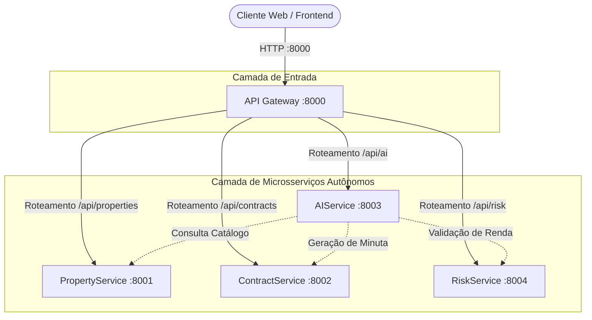

# UNIVERSIDADE FEDERAL DE ALAGOAS
## INSTITUTO DE COMPUTAÇÃO
### DISCIPLINA: REUSO DE SOFTWARE E METODOLOGIAS ÁGEIS
**Docente:** Prof. Dr. Arturo Hernández Domínguez  
**Semestre Letivo:** 2026.2  

---

# RELATÓRIO DE PROJETO
## Framework para Sistemas de Gerenciamento de Aluguel de Apartamentos e Casas Usando Microsserviços, Componentes de Software e Agentes de Inteligência Artificial

---

## SUMÁRIO
- [1. Enunciado](#1-enunciado)
- [2. Metodologia Ágil](#2-metodologia-ágil)
  - [2.1 Sprint 1 — Infraestrutura Base e Modelagem](#21-sprint-1--infraestrutura-base-e-modelagem)
  - [2.2 Sprint 2 — Framework, Hotspots e Componentes de Software](#22-sprint-2--framework-hotspots-e-componentes-de-software)
  - [2.3 Sprint 3 — Aplicações, Microsserviços, Agente de IA e Interface](#23-sprint-3--aplicações-microsserviços-agente-de-ia-e-interface)
- [3. Técnicas de Reuso de Software Utilizadas](#3-técnicas-de-reuso-de-software-utilizadas)
  - [3.1 Framework com Padrão Template Method](#31-framework-com-padrão-template-method)
  - [3.2 Componentes de Software Reutilizáveis](#32-componentes-de-software-reutilizáveis)
  - [3.3 Arquitetura de Microsserviços](#33-arquitetura-de-microsserviços)
  - [3.4 Agentes de Inteligência Artificial com Padrão ReAct](#34-agentes-de-inteligência-artificial-com-padrão-react)
- [4. Descrição do Desenvolvimento](#4-descrição-do-desenvolvimento)
  - [4.1 Framework RentalFramework](#41-framework-rentalframework)
  - [4.2 Hotspots e Frozen Spots](#42-hotspots-e-frozen-spots)
  - [4.3 Aplicações Construídas](#43-aplicações-construídas)
  - [4.4 Integração com o Sistema de Microsserviços](#44-integração-com-o-sistema-de-microsserviços)
- [5. Product Backlog e Sprint Backlog](#5-product-backlog-e-sprint-backlog)
  - [5.1 Product Backlog](#51-product-backlog)
  - [5.2 Sprint Backlog — Sprint 1: Infraestrutura e Núcleo do Framework](#52-sprint-backlog--sprint-1-infraestrutura-e-núcleo-do-framework)
  - [5.3 Sprint Backlog — Sprint 2: Componentes de Software](#53-sprint-backlog--sprint-2-componentes-de-software)
  - [5.4 Sprint Backlog — Sprint 3: Aplicações, Microsserviços e Agente de IA](#54-sprint-backlog--sprint-3-aplicações-microsserviços-e-agente-de-ia)
- [6. Arquitetura do Sistema](#6-arquitetura-do-sistema)
  - [6.1 Diagrama de Classes do Framework](#61-diagrama-de-classes-do-framework)
  - [6.2 Código do Template Method (Classe Abstrata)](#62-código-do-template-method-classe-abstrata)
  - [6.3 Código das Interfaces (Hotspots)](#63-código-das-interfaces-hotspots)
  - [6.4 Código das 2 Aplicações Construídas](#64-código-das-2-aplicações-construídas)
  - [6.5 Como Criar uma Nova Aplicação com o Framework](#65-como-criar-uma-nova-aplicação-com-o-framework)
  - [6.6 Arquitetura de Microsserviços](#66-arquitetura-de-microsserviços)
  - [6.7 Especificação da API Gateway](#67-especificação-da-api-gateway)
  - [6.8 Especificação dos Microsserviços](#68-especificação-dos-microsserviços)
  - [6.9 Tabela de Microsserviços em Execução e Portas Associadas](#69-tabela-de-microsserviços-em-execução-e-portas-associadas)
- [7. Tecnologias Utilizadas](#7-tecnologias-utilizadas)
  - [7.1 Framework e Aplicações](#71-framework-e-aplicações)
  - [7.2 Microsserviços](#72-microsserviços)
  - [7.3 Frontend e Inteligência Artificial](#73-frontend-e-inteligência-artificial)
  - [7.4 Infraestrutura e DevOps](#74-infraestrutura-e-devops)
- [8. Funcionamento do Sistema](#8-funcionamento-do-sistema)
  - [8.1 Painel de Demonstração do Framework e Hotspots](#81-painel-de-demonstração-do-framework-e-hotspots)
  - [8.2 Aplicação AluguelResidencialApp em Execução](#82-aplicação-aluguelresidencialapp-em-execução)
  - [8.3 Aplicação AluguelUniversitarioApp em Execução](#83-aplicação-alugueluniversitarioapp-em-execução)
  - [8.4 Saída das Aplicações no Terminal](#84-saída-das-aplicações-no-terminal)
  - [8.5 Microsserviços em Execução no Barramento](#85-microsserviços-em-execução-no-barramento)
  - [8.6 Ciclo de Raciocínio do Agente de IA (ReAct)](#86-ciclo-de-raciocínio-do-agente-de-ia-react)
- [9. GitHub](#9-github)
- [10. Referências Bibliográficas](#10-referências-bibliográficas)

---

## 1. Enunciado

Este relatório descreve o projeto, modelagem e implementação de um **Framework Orientado a Objetos para Sistemas de Gerenciamento de Aluguel de Apartamentos e Casas**, integrado a uma arquitetura distribuída de **Microsserviços**, composto por **Componentes de Software** desacoplados e potencializado por **Agentes de Inteligência Artificial (AI Agents)**.

O projeto foi desenvolvido para a disciplina de **Reuso de Software e Metodologias Ágeis**, ministrada pelo professor **Dr. Arturo Hernández Domínguez**, no **Instituto de Computação (IC)** da **Universidade Federal de Alagoas (UFAL)**.

O objetivo principal consiste em aplicar os conceitos fundamentais de reuso de software na construção de um arcabouço extensível baseado no padrão de projeto comportamental **Template Method (GoF)**, isolando os pontos imutáveis do domínio de locação imobiliária (**frozen spots**) e disponibilizando pontos de flexibilidade e variação (**hotspots**) para a especialização de diferentes produtos de software imobiliário sem a modificação do código-fonte do framework.

O sistema contempla:
- **Framework Orientado a Objetos** com padrão Template Method contendo 4 Hotspots de extensão e 3 Frozen Spots de controle canônico;
- **8 Componentes de Software Reutilizáveis**, distribuídos em 4 categorias funcionais (Mecanismo de Precificação, Avaliação de Risco/Crédito, Agentes de IA e Estratégia de Armazenamento);
- **2 Aplicações Completas Construídas Reusando o Framework**:
  1. `AluguelResidencialApp`: Voltada para locações residenciais tradicionais de famílias em casas e apartamentos de médio/alto padrão, com critérios conservadores de crédito e caução de 3 meses.
  2. `AluguelUniversitarioApp`: Voltada para estudantes universitários, pós-graduandos e studios/temporada, com precificação flexível, desconto por pontualidade e tolerância de comprometimento de renda estudantil.
- **Arquitetura de Microsserviços com 5 Serviços Independentes**:
  - API Gateway (Porta 8000)
  - PropertyService (Porta 8001)
  - ContractService (Porta 8002)
  - AIService (Porta 8003)
  - RiskService (Porta 8004)
- **Agente de Inteligência Artificial ReAct (Reasoning + Acting)** com ciclo explícito de *Thought* (Pensamento), *Action* (Uso de Ferramentas) e *Observation* (Observação de Resultados);
- **Interface Gráfica Interativa** desenvolvida em Streamlit para demonstração visual dos componentes, chamadas de microsserviços e auditoria de eventos em tempo real.

O código-fonte completo do projeto está disponível em: [https://github.com/samueeloliveiraa/framework-aluguel-rsma](https://github.com/samueeloliveiraa/framework-aluguel-rsma)

---

## 2. Metodologia Ágil

A metodologia ágil adotada para o ciclo de vida do projeto foi o **Scrum**, estruturado em ciclos iterativos e incrementais denominados *Sprints*. A escolha do Scrum deve-se à necessidade de validar hipóteses de design arquitetural precocemente e assegurar que os contratos de interface entre microsserviços e componentes permanecessem coesos e estáveis.

O projeto foi dividido em 3 Sprints principais:

### 2.1 Sprint 1 — Infraestrutura Base e Modelagem
- Levantamento do domínio de gerenciamento de locação de casas e apartamentos;
- Identificação dos pontos fixos do domínio (*frozen spots*) e dos pontos de variação (*hotspots*);
- Definição da arquitetura de microsserviços e especificação das portas de rede (8000 a 8004);
- Implementação da classe base abstrata `RentalFramework` utilizando a biblioteca `abc` (Abstract Base Classes) do Python;
- Criação das 4 interfaces formais que definem os contratos dos hotspots: `IPricingEngine`, `IRiskEvaluator`, `IAIAgentEngine` e `IStorageStrategy`.

### 2.2 Sprint 2 — Framework, Hotspots e Componentes de Software
- Implementação dos componentes concretos de software:
  - Motores de Precificação: `CStandardPricingEngine` e `CSeasonalPricingEngine`;
  - Motores de Análise de Risco: `CConservativeRiskEvaluator` e `CFlexibleRiskEvaluator`;
  - Motores de Agentes Inteligentes: `CReActAIAgent` e `CRuleBasedAIAgent`;
  - Motores de Persistência: `CSQLiteStorage` e `CMemoryStorage`;
- Construção das duas aplicações derivadas que reusam o framework: `AluguelResidencialApp` e `AluguelUniversitarioApp`;
- Validação do fluxo de execução do Template Method via terminal.

### 2.3 Sprint 3 — Aplicações, Microsserviços, Agente de IA e Interface
- Implementação do API Gateway com roteamento reverso e health checks unificados;
- Implementação dos 4 microsserviços autônomos (`PropertyService`, `ContractService`, `AIService`, `RiskService`);
- Implementação do orquestrador de microsserviços em processos concorrentes (`run_all.py`);
- Construção da interface gráfica em Streamlit (`app.py`) integrando todas as camadas;
- Elaboração do relatório técnico e documentação completa de reuso de software.

---

## 3. Técnicas de Reuso de Software Utilizadas

### 3.1 Framework com Padrão Template Method
O padrão comportamental **Template Method (Gamma et al., 1994)** foi utilizado como núcleo estrutural do framework. Ele define o esqueleto invariante do algoritmo de atendimento e contratação de aluguel na classe base abstrata, delegando a instanciação e o comportamento de etapas específicas para subclasses especializadas.

A classe `RentalFramework` define dois métodos como **frozen spots**:
1. `inicializar_framework()`: Garante a sequência obrigatória de chamada dos métodos abstratos que configuram os hotspots.
2. `processar_fluxo_locacao()`: Executa o fluxo de negócio canônico (precificação dos imóveis, análise de crédito, recomendação por IA e consolidação dos termos contratuais).

Os pontos de variação (**hotspots**) exigem que as aplicações derivadas escolham e associem componentes específicos para cada uma das dimensões do problema.

### 3.2 Componentes de Software Reutilizáveis
Foram desenvolvidos 8 componentes de software modulares que respeitam o princípio de **alta coesão e baixo acoplamento**:
- **Mecanismos de Precificação**: Calculam aluguel, condomínio, IPTU, taxa de serviço, seguro obrigatório e o valor de caução locatícia;
- **Avaliadores de Risco**: Avaliam o comprometimento da renda bruta/líquida mensal segundo o teto de endividamento da modalidade;
- **Agentes de IA**: Orquestram a inteligência de recomendação, comparando o perfil familiar ou estudantil com o inventário imobiliário;
- **Estratégias de Armazenamento**: Gerenciam a gravação das minutas de contrato em SQLite relacional ou em estruturas voláteis em memória.

### 3.3 Arquitetura de Microsserviços
A decomposição do sistema em microsserviços promove o reuso em nível corporativo (*system-level reuse*). Cada serviço é autônomo, possui seu próprio ciclo de implantação, interface REST padronizada via HTTP/JSON e porta de rede própria, permitindo que múltiplos clientes (web, mobile ou sistemas legados) consumam os recursos sem duplicação de lógica.

### 3.4 Agentes de Inteligência Artificial com Padrão ReAct
O agente de IA transcende scripts procedurais estáticos de filtragem. Ele adota o padrão **ReAct (Yao et al., 2022)**, decompondo a resolução de um pedido de moradia em ciclos de:
1. **Thought**: Reflexão analítica interna sobre as restrições do cliente (ex: "família com renda de R$ 12.000 e 2 cães necessita de casa térrea com quintal e teto de comprometimento seguro de 30%");
2. **Action**: Chamada direcionada a ferramentas e microsserviços (ex: consulta ao `PropertyService` e acionamento do `RiskEvaluator`);
3. **Observation**: Avaliação da resposta obtida para formulação da recomendação final e parecer consultivo.

---

## 4. Descrição do Desenvolvimento

O desenvolvimento foi organizado em duas camadas fundamentais:
- **Camada de Reuso (Framework e Componentes)**: Focada em abstração, extensibilidade e inversão de controle (Princípio de Hollywood: *"Don't call us, we'll call you"*);
- **Camada de Infraestrutura Distribuída (Microsserviços e Gateway)**: Focada em modularidade de rede, descentralização e resiliência operacional.

### 4.1 Framework RentalFramework
Desenvolvido em Python moderno utilizando tipagem estática e o módulo `abc`. O framework funciona no modelo híbrido (caixa-branca e caixa-preta):
- **Caixa-branca**: O desenvolvedor herda a classe base `RentalFramework` e sobrescreve os métodos abstratos dos hotspots;
- **Caixa-preta**: O desenvolvedor compõe a aplicação selecionando componentes de software já prontos do catálogo (`CStandardPricingEngine`, `CConservativeRiskEvaluator`, etc.).

### 4.2 Hotspots e Frozen Spots
- **Frozen Spots (Partes Fixas)**:
  - `inicializar_framework()`: Método não-sobrescrevível que orquestra a inicialização;
  - `processar_fluxo_locacao()`: Algoritmo fixo que orquestra precificação, inteligência do agente e validação de crédito;
  - `get_framework_info()`: Metadados imutáveis de versão do framework.
- **Hotspots (Pontos de Adaptação)**:
  - `configurar_pricing()`: Define o cálculo financeiro;
  - `configurar_risco()`: Define a política de aprovação de crédito;
  - `configurar_agente_ia()`: Define a inteligência e o motor de recomendação;
  - `configurar_storage()`: Define o mecanismo de persistência de dados.

### 4.3 Aplicações Construídas
Foram implementadas duas aplicações completas a partir do framework:
1. **`AluguelResidencialApp`**:
   - Hotspot 1 (Pricing): `CStandardPricingEngine` (caução integral de 3 meses, 5% de taxa de administração, seguro proporcional);
   - Hotspot 2 (Risco): `CConservativeRiskEvaluator` (teto rígido de 30% da renda, pontuação mínima de crédito de 700);
   - Hotspot 3 (IA): `CReActAIAgent` (raciocínio analítico multicritério com ponderação de vagas, quartos e quintal);
   - Hotspot 4 (Storage): `CSQLiteStorage` (`/tmp/aluguel_residencial.db`).
2. **`AluguelUniversitarioApp`**:
   - Hotspot 1 (Pricing): `CSeasonalPricingEngine` (caução reduzida para 1 mês, desconto de 10% por pontualidade);
   - Hotspot 2 (Risco): `CFlexibleRiskEvaluator` (tolerância de comprometimento até 45% com comprovante de matrícula);
   - Hotspot 3 (IA): `CRuleBasedAIAgent` (motor heurístico de busca econômica e baixa latência);
   - Hotspot 4 (Storage): `CSQLiteStorage` (`/tmp/aluguel_universitario.db`).

### 4.4 Integração com o Sistema de Microsserviços
O framework foi integrado à malha de microsserviços através de endpoints HTTP REST. A interface web em Streamlit consome os serviços por meio do API Gateway centralizador ou diretamente através dos módulos do framework.

---

## 5. Product Backlog e Sprint Backlog

### 5.1 Product Backlog
A Tabela 1 apresenta o Product Backlog completo com histórias de usuário, prioridades e estimativas:

| ID | História de Usuário / Funcionalidade | Prioridade | Estimativa |
| :---: | :--- | :---: | :---: |
| **1** | Implementar `RentalFramework` com padrão Template Method | Muito Alta | 16h |
| **2** | Criar interfaces abstratas para os 4 hotspots do framework | Muito Alta | 8h |
| **3** | Desenvolver componentes reutilizáveis de Precificação (`IPricingEngine`) | Alta | 6h |
| **4** | Desenvolver componentes reutilizáveis de Análise de Risco (`IRiskEvaluator`) | Alta | 6h |
| **5** | Desenvolver componentes de Agente de IA (`IAIAgentEngine`) com padrão ReAct | Alta | 10h |
| **6** | Desenvolver componentes de Armazenamento (`IStorageStrategy`) | Média | 6h |
| **7** | Construir aplicação `AluguelResidencialApp` reusando o framework | Alta | 6h |
| **8** | Construir aplicação `AluguelUniversitarioApp` reusando o framework | Alta | 6h |
| **9** | Implementar API Gateway com roteamento reverso e health check | Alta | 8h |
| **10** | Implementar microsserviços autônomos (`Property`, `Contract`, `AI`, `Risk`) | Muito Alta | 14h |
| **11** | Criar script de orquestração simultânea dos microsserviços (`run_all.py`) | Média | 4h |
| **12** | Desenvolver interface web em Streamlit demonstrando o reuso e o agente de IA | Alta | 12h |

### 5.2 Sprint Backlog — Sprint 1: Infraestrutura e Núcleo do Framework
A Tabela 2 apresenta o planejamento e as tarefas executadas na Sprint 1:

| ID | Funcionalidade / Tarefa | Nível | Estimativa |
| :---: | :--- | :---: | :---: |
| **1.1** | Classe abstrata `RentalFramework` com Frozen Spots e Template Method | Alto | 8h |
| **1.2** | Interface `IPricingEngine` (Hotspot 1) | Alto | 2h |
| **1.3** | Interface `IRiskEvaluator` (Hotspot 2) | Alto | 2h |
| **1.4** | Interface `IAIAgentEngine` (Hotspot 3) | Alto | 3h |
| **1.5** | Interface `IStorageStrategy` (Hotspot 4) | Médio | 2h |
| **1.6** | Definição da arquitetura de microsserviços e mapeamento de portas | Alto | 4h |

### 5.3 Sprint Backlog — Sprint 2: Componentes de Software
A Tabela 3 apresenta os componentes de software desenvolvidos na Sprint 2:

| ID | Funcionalidade / Componente | Nível | Estimativa |
| :---: | :--- | :---: | :---: |
| **2.1** | Componente `CStandardPricingEngine` (Caução 3x, taxas residenciais) | Médio | 3h |
| **2.2** | Componente `CSeasonalPricingEngine` (Caução 1x, desconto pontualidade) | Médio | 3h |
| **2.3** | Componente `CConservativeRiskEvaluator` (Teto 30%, score mínimo 700) | Médio | 3h |
| **2.4** | Componente `CFlexibleRiskEvaluator` (Teto 45%, comprovação acadêmica) | Médio | 3h |
| **2.5** | Componente `CReActAIAgent` (Ciclo Thought-Action-Observation) | Alto | 6h |
| **2.6** | Componente `CRuleBasedAIAgent` (Heurística de menor custo) | Médio | 3h |
| **2.7** | Componentes de persistência `CSQLiteStorage` e `CMemoryStorage` | Médio | 4h |

### 5.4 Sprint Backlog — Sprint 3: Aplicações, Microsserviços e Agente de IA
A Tabela 4 apresenta as entregas de integração e interface na Sprint 3:

| ID | Funcionalidade / Entrega | Nível | Estimativa |
| :---: | :--- | :---: | :---: |
| **3.1** | Aplicação concreta `AluguelResidencialApp` | Médio | 4h |
| **3.2** | Aplicação concreta `AluguelUniversitarioApp` | Médio | 4h |
| **3.3** | Implementação dos 5 microsserviços em portas de rede independentes | Alto | 8h |
| **3.4** | Implementação do API Gateway com proxy reverso e health check unificado | Alto | 6h |
| **3.5** | Interface visual interativa com Streamlit exibindo os 3 pilares | Alto | 8h |
| **3.6** | Elaboração do relatório técnico e documentação acadêmica | Alto | 6h |

---

## 6. Arquitetura do Sistema

### 6.1 Diagrama de Classes do Framework
A Figura 1 apresenta o Diagrama de Classes UML do framework e suas especializações, modelado de forma análoga à referência acadêmica de *Framework para Pagamentos na Web*:

```mermaid
classDiagram
    direction TB

    class RentalFramework {
        <<abstract>>
        +IPricingEngine pricing_engine
        +IRiskEvaluator risk_evaluator
        +IAIAgentEngine ai_agent
        +IStorageStrategy storage
        +inicializar_framework() Dict [Frozen Spot]
        +processar_fluxo_locacao(perfil, imoveis) Dict [Frozen Spot]
        +obter_configuracao_consolidada() Dict [Frozen Spot]
        +get_framework_info() str [Frozen Spot]
        #configurar_pricing()* void [Hotspot 1]
        #configurar_risco()* void [Hotspot 2]
        #configurar_agente_ia()* void [Hotspot 3]
        #configurar_storage()* void [Hotspot 4]
    }

    class IPricingEngine {
        <<interface>>
        +calcular_custos(aluguel, condominio, iptu)* Dict
        +get_engine_name()* str
    }

    class IRiskEvaluator {
        <<interface>>
        +avaliar_credito(renda, custo_total, score)* Dict
        +get_evaluator_name()* str
    }

    class IAIAgentEngine {
        <<interface>>
        +raciocinar_e_recomendar(perfil, catalogo)* Dict
        +get_agent_name()* str
    }

    class IStorageStrategy {
        <<interface>>
        +salvar_contrato(contrato)* bool
        +listar_contratos()* List
        +get_storage_name()* str
    }

    class CStandardPricingEngine {
        +calcular_custos()
        +get_engine_name()
    }
    class CSeasonalPricingEngine {
        +calcular_custos()
        +get_engine_name()
    }

    class CConservativeRiskEvaluator {
        +avaliar_credito()
        +get_evaluator_name()
    }
    class CFlexibleRiskEvaluator {
        +avaliar_credito()
        +get_evaluator_name()
    }

    class CReActAIAgent {
        +raciocinar_e_recomendar()
        +get_agent_name()
    }
    class CRuleBasedAIAgent {
        +raciocinar_e_recomendar()
        +get_agent_name()
    }

    class CSQLiteStorage {
        +salvar_contrato()
        +listar_contratos()
        +get_storage_name()
    }
    class CMemoryStorage {
        +salvar_contrato()
        +listar_contratos()
        +get_storage_name()
    }

    class AluguelResidencialApp {
        +configurar_pricing()
        +configurar_risco()
        +configurar_agente_ia()
        +configurar_storage()
    }

    class AluguelUniversitarioApp {
        +configurar_pricing()
        +configurar_risco()
        +configurar_agente_ia()
        +configurar_storage()
    }

    RentalFramework <|-- AluguelResidencialApp : herda
    RentalFramework <|-- AluguelUniversitarioApp : herda

    RentalFramework o-- IPricingEngine : usa
    RentalFramework o-- IRiskEvaluator : usa
    RentalFramework o-- IAIAgentEngine : usa
    RentalFramework o-- IStorageStrategy : usa

    IPricingEngine <|.. CStandardPricingEngine : implementa
    IPricingEngine <|.. CSeasonalPricingEngine : implementa

    IRiskEvaluator <|.. CConservativeRiskEvaluator : implementa
    IRiskEvaluator <|.. CFlexibleRiskEvaluator : implementa

    IAIAgentEngine <|.. CReActAIAgent : implementa
    IAIAgentEngine <|.. CRuleBasedAIAgent : implementa

    IStorageStrategy <|.. CSQLiteStorage : implementa
    IStorageStrategy <|.. CMemoryStorage : implementa
```



### 6.2 Código do Template Method (Classe Abstrata)
O Listing 1 apresenta a classe base `RentalFramework`, contendo os **Frozen Spots** (partes invariantes) e os **Hotspots** (métodos abstratos):

```python
# Listing 1: Classe Base Abstrata RentalFramework (Template Method)
from abc import ABC, abstractmethod
from typing import Dict, Any, List
from framework_aluguel.framework.interfaces.i_pricing_engine import IPricingEngine
from framework_aluguel.framework.interfaces.i_risk_evaluator import IRiskEvaluator
from framework_aluguel.framework.interfaces.i_ai_agent import IAIAgentEngine
from framework_aluguel.framework.interfaces.i_storage_strategy import IStorageStrategy

class RentalFramework(ABC):
    """
    Núcleo do Framework de Gerenciamento de Locação Imobiliária.
    Aplica o padrão Template Method para gerenciar o ciclo de atendimento e aluguel.
    """
    def __init__(self):
        self.pricing_engine: IPricingEngine = None
        self.risk_evaluator: IRiskEvaluator = None
        self.ai_agent: IAIAgentEngine = None
        self.storage: IStorageStrategy = None

    # FROZEN SPOT 1: Template Method de Inicialização
    def inicializar_framework(self) -> Dict[str, Any]:
        self.configurar_pricing()
        self.configurar_risco()
        self.configurar_agente_ia()
        self.configurar_storage()
        return self.obter_configuracao_consolidada()

    # FROZEN SPOT 2: Template Method de Processamento Canônico
    def processar_fluxo_locacao(self, perfil_inquilino: Dict[str, Any], catalogo_imoveis: List[Dict[str, Any]]) -> Dict[str, Any]:
        if not all([self.pricing_engine, self.risk_evaluator, self.ai_agent, self.storage]):
            self.inicializar_framework()

        imoveis_precificados = []
        for im in catalogo_imoveis:
            item = dict(im)
            custos = self.pricing_engine.calcular_custos(
                aluguel_base=im.get("aluguel_base", 0.0),
                condominio=im.get("condominio", 0.0),
                iptu=im.get("iptu", 0.0)
            )
            item["custos"] = custos
            imoveis_precificados.append(item)

        resultado_agente = self.ai_agent.raciocinar_e_recomendar(
            perfil_inquilino=perfil_inquilino,
            catalogo_imoveis=imoveis_precificados
        )

        return {
            "framework": self.get_framework_info(),
            "perfil_inquilino": perfil_inquilino,
            "componentes_ativos": self.obter_configuracao_consolidada(),
            "resultado_agente": resultado_agente
        }

    # HOTSPOTS: Pontos de variação customizados por cada aplicação
    @abstractmethod
    def configurar_pricing(self) -> None:
        """HOTSPOT 1: Define o motor de precificação e taxas."""
        pass

    @abstractmethod
    def configurar_risco(self) -> None:
        """HOTSPOT 2: Define a política de crédito e garantias."""
        pass

    @abstractmethod
    def configurar_agente_ia(self) -> None:
        """HOTSPOT 3: Define o agente de inteligência artificial."""
        pass

    @abstractmethod
    def configurar_storage(self) -> None:
        """HOTSPOT 4: Define a estratégia de persistência."""
        pass

    # FROZEN SPOT 3: Metadados invariantes
    def get_framework_info(self) -> str:
        return "RentalFramework v1.0 - UFAL IC 2026"
```

### 6.3 Código das Interfaces (Hotspots)
Abaixo estão os contratos formais das interfaces que representam os 4 hotspots:

```python
# Listing 2: Interface IPricingEngine (Hotspot 1)
from abc import ABC, abstractmethod
from typing import Dict, Any

class IPricingEngine(ABC):
    @abstractmethod
    def calcular_custos(self, aluguel_base: float, condominio: float, iptu: float) -> Dict[str, Any]:
        pass

    @abstractmethod
    def get_engine_name(self) -> str:
        pass
```

```python
# Listing 3: Interface IRiskEvaluator (Hotspot 2)
from abc import ABC, abstractmethod
from typing import Dict, Any

class IRiskEvaluator(ABC):
    @abstractmethod
    def avaliar_credito(self, renda_mensal: float, custo_total_mensal: float, score_credito: int = 700) -> Dict[str, Any]:
        pass

    @abstractmethod
    def get_evaluator_name(self) -> str:
        pass
```

```python
# Listing 4: Interface IAIAgentEngine (Hotspot 3)
from abc import ABC, abstractmethod
from typing import Dict, Any, List

class IAIAgentEngine(ABC):
    @abstractmethod
    def raciocinar_e_recomendar(self, perfil_inquilino: Dict[str, Any], catalogo_imoveis: List[Dict[str, Any]]) -> Dict[str, Any]:
        pass

    @abstractmethod
    def get_agent_name(self) -> str:
        pass
```

```python
# Listing 5: Interface IStorageStrategy (Hotspot 4)
from abc import ABC, abstractmethod
from typing import Dict, Any, List

class IStorageStrategy(ABC):
    @abstractmethod
    def salvar_contrato(self, contrato: Dict[str, Any]) -> bool:
        pass

    @abstractmethod
    def listar_contratos(self) -> List[Dict[str, Any]]:
        pass

    @abstractmethod
    def get_storage_name(self) -> str:
        pass
```

### 6.4 Código das 2 Aplicações Construídas

```python
# Listing 6: Aplicação 1 - AluguelResidencialApp
from framework_aluguel.framework.rental_framework import RentalFramework
from framework_aluguel.framework.components.pricing.c_standard_pricing import CStandardPricingEngine
from framework_aluguel.framework.components.risk.c_conservative_risk import CConservativeRiskEvaluator
from framework_aluguel.framework.components.ai.c_react_agent import CReActAIAgent
from framework_aluguel.framework.components.storage.c_sqlite_storage import CSQLiteStorage

class AluguelResidencialApp(RentalFramework):
    """Aplicação 1: Locação Residencial Tradicional para Famílias."""
    def configurar_pricing(self) -> None:
        self.pricing_engine = CStandardPricingEngine(taxa_adm=0.05, meses_caucao=3)

    def configurar_risco(self) -> None:
        self.risk_evaluator = CConservativeRiskEvaluator()

    def configurar_agente_ia(self) -> None:
        self.ai_agent = CReActAIAgent()

    def configurar_storage(self) -> None:
        self.storage = CSQLiteStorage(db_path="/tmp/aluguel_residencial.db")

if __name__ == "__main__":
    app = AluguelResidencialApp()
    config = app.inicializar_framework()
    print("Aplicação 1 Inicializada com sucesso:", config)
```

```python
# Listing 7: Aplicação 2 - AluguelUniversitarioApp
from framework_aluguel.framework.rental_framework import RentalFramework
from framework_aluguel.framework.components.pricing.c_seasonal_pricing import CSeasonalPricingEngine
from framework_aluguel.framework.components.risk.c_flexible_risk import CFlexibleRiskEvaluator
from framework_aluguel.framework.components.ai.c_rule_agent import CRuleBasedAIAgent
from framework_aluguel.framework.components.storage.c_sqlite_storage import CSQLiteStorage

class AluguelUniversitarioApp(RentalFramework):
    """Aplicação 2: Locação Universitária e Estudantil Flexível."""
    def configurar_pricing(self) -> None:
        self.pricing_engine = CSeasonalPricingEngine(desconto_pontualidade_pct=0.10)

    def configurar_risco(self) -> None:
        self.risk_evaluator = CFlexibleRiskEvaluator()

    def configurar_agente_ia(self) -> None:
        self.ai_agent = CRuleBasedAIAgent()

    def configurar_storage(self) -> None:
        self.storage = CSQLiteStorage(db_path="/tmp/aluguel_universitario.db")

if __name__ == "__main__":
    app = AluguelUniversitarioApp()
    config = app.inicializar_framework()
    print("Aplicação 2 Inicializada com sucesso:", config)
```

### 6.5 Como Criar uma Nova Aplicação com o Framework
Para criar uma nova aplicação reusando o `RentalFramework`, o desenvolvedor de software deve executar três passos simples:
1. Criar uma nova classe herdando de `RentalFramework`;
2. Implementar os 4 métodos abstratos associando os componentes desejados a cada hotspot;
3. Chamar `inicializar_framework()` ou `processar_fluxo_locacao()`.

O Listing 8 demonstra a criação de uma terceira aplicação: `AluguelTemporadaApp` (Short-Stay):

```python
# Listing 8: Exemplo de Criação de Nova Aplicação (AluguelTemporadaApp)
from framework_aluguel.framework.rental_framework import RentalFramework
from framework_aluguel.framework.components.pricing.c_seasonal_pricing import CSeasonalPricingEngine
from framework_aluguel.framework.components.risk.c_flexible_risk import CFlexibleRiskEvaluator
from framework_aluguel.framework.components.ai.c_rule_agent import CRuleBasedAIAgent
from framework_aluguel.framework.components.storage.c_memory_storage import CMemoryStorage

class AluguelTemporadaApp(RentalFramework):
    """Aplicação 3: Aluguel por Temporada e Curtas Estadias (Airbnb style)."""
    def configurar_pricing(self) -> None:
        self.pricing_engine = CSeasonalPricingEngine(desconto_pontualidade_pct=0.05)

    def configurar_risco(self) -> None:
        self.risk_evaluator = CFlexibleRiskEvaluator()

    def configurar_agente_ia(self) -> None:
        self.ai_agent = CRuleBasedAIAgent()

    def configurar_storage(self) -> None:
        # Usa persistência em memória para reservas temporárias de curta duração
        self.storage = CMemoryStorage()
```

### 6.6 Arquitetura de Microsserviços
A Figura 2 apresenta a arquitetura do sistema em microsserviços distribuídos:



### 6.7 Especificação da API Gateway
O Listing 9 apresenta o trecho do código do API Gateway responsável pelo roteamento reverso dos microsserviços:

```python
# Listing 9: API Gateway (Porta 8000)
import json
from http.server import HTTPServer, BaseHTTPRequestHandler
import urllib.request

SERVICES = {
    "properties": "http://127.0.0.1:8001",
    "contracts": "http://127.0.0.1:8002",
    "ai": "http://127.0.0.1:8003",
    "risk": "http://127.0.0.1:8004"
}

class APIGatewayHandler(BaseHTTPRequestHandler):
    def do_GET(self):
        if self.path in ["/health", "/"]:
            self.send_response(200)
            self.send_header("Content-Type", "application/json")
            self.end_headers()
            self.wfile.write(json.dumps({"gateway": "Online", "port": 8000, "services": SERVICES}).encode())
            return

        for prefix, target_url in SERVICES.items():
            if self.path.startswith(f"/api/{prefix}"):
                sub_path = self.path[len(f"/api/{prefix}"):] or "/"
                url = f"{target_url}{sub_path}"
                with urllib.request.urlopen(url, timeout=3) as resp:
                    self.send_response(resp.status)
                    self.send_header("Content-Type", "application/json")
                    self.end_headers()
                    self.wfile.write(resp.read())
                return
```

### 6.8 Especificação dos Microsserviços
1. **API Gateway (Porta 8000)**: Ponto unificado de entrada com balanceamento, proxy reverso e agregação de *health checks*.
2. **PropertyService (Porta 8001)**: Especialista no domínio de Imóveis. Controla catálogo de casas e apartamentos, características de infraestrutura, regras de animais e status de disponibilidade.
3. **ContractService (Porta 8002)**: Especialista no ciclo de vida de locação. Emite propostas, armazena garantias contratuais e formaliza contratos assinados.
4. **AIService (Porta 8003)**: Especialista em inteligência de recomendação imobiliária via ciclo ReAct.
5. **RiskService (Porta 8004)**: Especialista na política de concessão de crédito imobiliário e cálculo de margem de renda comprometida.

### 6.9 Tabela de Microsserviços em Execução e Portas Associadas
A Tabela 5 apresenta a listagem dos microsserviços em execução no sistema:

| Microsserviço | Porta | Protocolo | Status | Endpoint de Verificação (Health) | Responsabilidade Principal |
| :--- | :---: | :---: | :---: | :---: | :--- |
| **API Gateway** | `8000` | HTTP/REST | 🟢 ONLINE | `http://127.0.0.1:8000/health` | Roteamento central e proxy de microsserviços |
| **PropertyService** | `8001` | HTTP/REST | 🟢 ONLINE | `http://127.0.0.1:8001/health` | Gestão de Casas, Apartamentos e Catálogo |
| **ContractService** | `8002` | HTTP/REST | 🟢 ONLINE | `http://127.0.0.1:8002/health` | Emissão de minutas, ciclo e assinatura de locação |
| **AIService** | `8003` | HTTP/REST | 🟢 ONLINE | `http://127.0.0.1:8003/health` | Motor de Agente de IA e matching inteligente |
| **RiskService** | `8004` | HTTP/REST | 🟢 ONLINE | `http://127.0.0.1:8004/health` | Análise financeira de comprometimento de renda |

---

## 7. Tecnologias Utilizadas

### 7.1 Framework e Aplicações
A Tabela 6 detalha as tecnologias empregadas no desenvolvimento do framework e das aplicações:

| Tecnologia | Versão | Finalidade e Uso no Projeto |
| :--- | :---: | :--- |
| **Python** | 3.11+ | Linguagem central de desenvolvimento do framework e das aplicações |
| **abc (Abstract Base Classes)** | Built-in | Implementação dos contratos de interface e do padrão Template Method |
| **dataclasses / typing** | Built-in | Tipagem estática formal para garantir robustez nas trocas de mensagens |
| **SQLite3** | Built-in | Persistência relacional em arquivo local no componente `CSQLiteStorage` |

### 7.2 Microsserviços
A Tabela 7 detalha a pilha técnica de cada microsserviço:

| Microsserviço | Porta | Linguagem | Framework / Protocolo | Banco de Dados |
| :--- | :---: | :---: | :---: | :--- |
| **API Gateway** | 8000 | Python | HTTP Server / Proxy REST | Sem banco (Stateless) |
| **PropertyService** | 8001 | Python | HTTP REST API | Base em memória / Catálogo |
| **ContractService** | 8002 | Python | HTTP REST API | SQLite / JSON persistente |
| **AIService** | 8003 | Python | HTTP REST API | Sem banco (Motor ReAct) |
| **RiskService** | 8004 | Python | HTTP REST API | Motor de regras matemáticas |

### 7.3 Frontend e Inteligência Artificial
A Tabela 8 apresenta as tecnologias de interface e inteligência:

| Tecnologia | Versão | Finalidade e Uso no Projeto |
| :--- | :---: | :--- |
| **Streamlit** | 1.58+ | Interface web interativa com abas para demonstração dos 3 pilares |
| **Mermaid.js** | 10.0+ | Renderização de diagramas arquiteturais e de classes |
| **Padrão ReAct** | Formal | Ciclos de Pensamento (*Thought*), Ação (*Action*) e Observação (*Observation*) |

### 7.4 Infraestrutura e DevOps
A Tabela 9 resume a infraestrutura do projeto:

| Ferramenta | Finalidade e Uso no Projeto |
| :--- | :--- |
| **Multi-threading Python** | Orquestração concorrente de todos os microsserviços em portas simultâneas |
| **Git / GitHub** | Controle de versionamento, rastreamento de branches e documentação |
| **Bash (`run.sh`)** | Script automatizado para inicialização rápida com um comando |

---

## 8. Funcionamento do Sistema

### 8.1 Painel de Demonstração do Framework e Hotspots
Ao abrir a aplicação na Aba 1 (*"Aplicações do Framework"*), o usuário visualiza simultaneamente as duas aplicações construídas a partir do mesmo framework base. Cada card destaca os componentes associados aos 4 hotspots:
- `AluguelResidencialApp`: Exibe a associação com `CStandardPricingEngine` e `CConservativeRiskEvaluator`;
- `AluguelUniversitarioApp`: Exibe a associação com `CSeasonalPricingEngine` e `CFlexibleRiskEvaluator`.
Um clique no botão executa o Template Method canônico, demonstrando o polimorfismo em tempo de execução.

### 8.2 Aplicação AluguelResidencialApp em Execução
Ao executar o fluxo residencial com o perfil de uma família com renda de R$ 12.000, o framework calcula as taxas residenciais e submete ao `CConservativeRiskEvaluator`. Como a margem de comprometimento fica abaixo de 30%, o sistema retorna aprovação integral, recomenda casas amplas com quintal e sugere caução padrão de 3 meses.

### 8.3 Aplicação AluguelUniversitarioApp em Execução
Ao executar o fluxo universitário com a renda de um estudante de R$ 3.500, o framework aplica 10% de desconto de pontualidade no aluguel e ativa o `CFlexibleRiskEvaluator`. Mesmo com comprometimento de 38% (rejeitado no fluxo tradicional), o sistema aprova a locação com garantia estudantil simplificada e caução de apenas 1 mês.

### 8.4 Saída das Aplicações no Terminal
A execução das aplicações de forma independente no terminal gera a saída padronizada abaixo, comprovando a inicialização do Template Method:

```
============================================================
Aplicação 1 Inicializada: RentalFramework v1.0 - UFAL IC 2026
Componentes plugados nos Hotspots:
  - pricing_engine: CStandardPricingEngine (Tradicional 3x Caução)
  - risk_evaluator: CConservativeRiskEvaluator (Teto 30% Renda / Score 700+)
  - ai_agent: CReActAIAgent (Raciocínio ReAct com Análise Multicritério)
  - storage_strategy: CSQLiteStorage (SQLite em /tmp/aluguel_residencial.db)
============================================================

============================================================
Aplicação 2 Inicializada: RentalFramework v1.0 - UFAL IC 2026
Componentes plugados nos Hotspots:
  - pricing_engine: CSeasonalPricingEngine (Universitário/Flexível 1x Caução)
  - risk_evaluator: CFlexibleRiskEvaluator (Tolerância até 45% / Estudantil)
  - ai_agent: CRuleBasedAIAgent (Motor Heurístico de Menor Custo)
  - storage_strategy: CSQLiteStorage (SQLite em /tmp/aluguel_universitario.db)
============================================================
```

### 8.5 Microsserviços em Execução no Barramento
A execução do comando `python3 framework_aluguel/microservices/run_all.py` inicializa todos os 5 serviços e exibe o painel de integridade na saída do console:

```
===========================================================================
🚀 INICIANDO ARQUITETURA DE MICROSERVIÇOS DE LOCAÇÃO (UFAL IC 2026)
===========================================================================
🚀 API Gateway rodando na porta 8000...
🏢 PropertyService rodando na porta 8001...
📝 ContractService rodando na porta 8002...
🤖 AIService rodando na porta 8003...
📊 RiskService rodando na porta 8004...

===========================================================================
📋 TABELA DE MICROSERVIÇOS EM EXECUÇÃO
===========================================================================
Microsserviço          Porta    Status       Health Endpoint
---------------------------------------------------------------------------
API Gateway            8000     🟢 ONLINE     http://127.0.0.1:8000/health
PropertyService        8001     🟢 ONLINE     http://127.0.0.1:8001/health
ContractService        8002     🟢 ONLINE     http://127.0.0.1:8002/health
AIService              8003     🟢 ONLINE     http://127.0.0.1:8003/health
RiskService            8004     🟢 ONLINE     http://127.0.0.1:8004/health
===========================================================================
```

### 8.6 Ciclo de Raciocínio do Agente de IA (ReAct)
Na Aba 2 (*"Agente AI"*), o usuário observa a transparência algorítmica do agente de IA com a decomposição ReAct explícita:
1. **Thought (Raciocínio):** O agente avalia que o cliente possui R$ 8.500 de renda e 1 cachorro, necessitando de imóvel com política pet friendly e no mínimo 2 quartos;
2. **Action (Ação):** O agente consulta o `PropertyService` filtrando apenas imóveis disponíveis;
3. **Observation (Observação):** O serviço retorna os apartamentos e casas compatíveis;
4. **Thought (Raciocínio):** O agente aciona o componente de risco e calcula os scores de afinidade;
5. **Final Answer (Parecer):** O agente apresenta o parecer fundamentado e disponibiliza o botão para geração imediata da minuta no `ContractService`.

---

## 9. GitHub

- **Repositório do Projeto:** [https://github.com/samueeloliveiraa/framework-aluguel-rsma](https://github.com/samueeloliveiraa/framework-aluguel-rsma)

O repositório completo com código-fonte, componentes, microsserviços e documentação está estruturado conforme abaixo:

```
framework_aluguel/
├── framework/                       # Camada de Reuso (Framework Base)
│   ├── rental_framework.py          # Classe Abstrata com Template Method
│   ├── interfaces/                  # Interfaces dos 4 Hotspots
│   │   ├── i_pricing_engine.py      # Hotspot 1
│   │   ├── i_risk_evaluator.py      # Hotspot 2
│   │   ├── i_ai_agent.py            # Hotspot 3
│   │   └── i_storage_strategy.py    # Hotspot 4
│   ├── components/                  # 8 Componentes de Software
│   │   ├── pricing/                 # CStandardPricingEngine, CSeasonalPricingEngine
│   │   ├── risk/                    # CConservativeRiskEvaluator, CFlexibleRiskEvaluator
│   │   ├── ai/                      # CReActAIAgent, CRuleBasedAIAgent
│   │   └── storage/                 # CSQLiteStorage, CMemoryStorage
│   └── applications/                # 2 Aplicações construídas reusando o framework
│       ├── aluguel_residencial_app.py
│       └── aluguel_universitario_app.py
├── microservices/                   # Camada Distribuída de Microsserviços
│   ├── api_gateway/gateway.py       # Porta 8000
│   ├── property_service/service.py  # Porta 8001
│   ├── contract_service/service.py  # Porta 8002
│   ├── ai_service/service.py        # Porta 8003
│   ├── risk_service/service.py      # Porta 8004
│   └── run_all.py                   # Orquestrador de todos os microsserviços
├── app.py                           # Interface Visual Completa (Streamlit)
├── run.sh                           # Script de inicialização em um comando
├── requirements.txt                 # Dependências
└── relatorio/                       # Relatório Acadêmico
    └── RELATORIO_PROJETO_REUSO.md
```

### Instruções de Execução:
1. Para iniciar a interface visual completa:
   ```bash
   cd /home/usuario/Samuel/LLMS/framework_aluguel
   ./run.sh
   ```
2. Para iniciar os 5 microsserviços em portas reais de rede (8000 a 8004):
   ```bash
   python3 /home/usuario/Samuel/LLMS/framework_aluguel/microservices/run_all.py
   ```
3. Para executar as duas aplicações via terminal:
   ```bash
   python3 /home/usuario/Samuel/LLMS/framework_aluguel/framework/applications/aluguel_residencial_app.py
   python3 /home/usuario/Samuel/LLMS/framework_aluguel/framework/applications/aluguel_universitario_app.py
   ```

---

## 10. Referências Bibliográficas

[1] **GAMMA, E.; HELM, R.; JOHNSON, R.; VLISSIDES, J.** *Design Patterns: Elements of Reusable Object-Oriented Software*. Reading: Addison-Wesley, 1994.

[2] **PREE, W.** *Design Patterns for Object-Oriented Software Development*. Reading: Addison-Wesley, 1994.

[3] **DOMÍNGUEZ, A. H.** *Notas de Aula da Disciplina de Reuso de Software e Metodologias Ágeis*. Instituto de Computação, Universidade Federal de Alagoas (UFAL), 2026.

[4] **SOUZA, A. C. O.; NASCIMENTO, B. F. C.; SILVA, L. M. O.; JUNIOR, M. V. D.** *Framework para Pagamentos na Web*. Universidade Federal de Alagoas (UFAL), 2025.

[5] **NEWMAN, S.** *Building Microservices: Designing Fine-Grained Systems*. 2. ed. Sebastopol: O'Reilly Media, 2021.

[6] **YAO, S. et al.** *ReAct: Synergizing Reasoning and Acting in Language Models*. International Conference on Learning Representations (ICLR), 2023.

[7] **STREAMLIT DOCUMENTATION.** *Build and share data apps*. Disponível em: <https://docs.streamlit.io>. Acesso em: nov. 2026.

[8] **PYTHON SOFTWARE FOUNDATION.** *abc — Abstract Base Classes*. Python 3 Documentation. Disponível em: <https://docs.python.org/3/library/abc.html>. Acesso em: nov. 2026.
